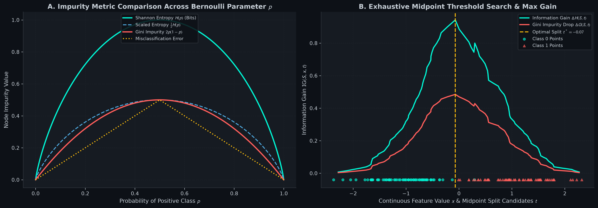
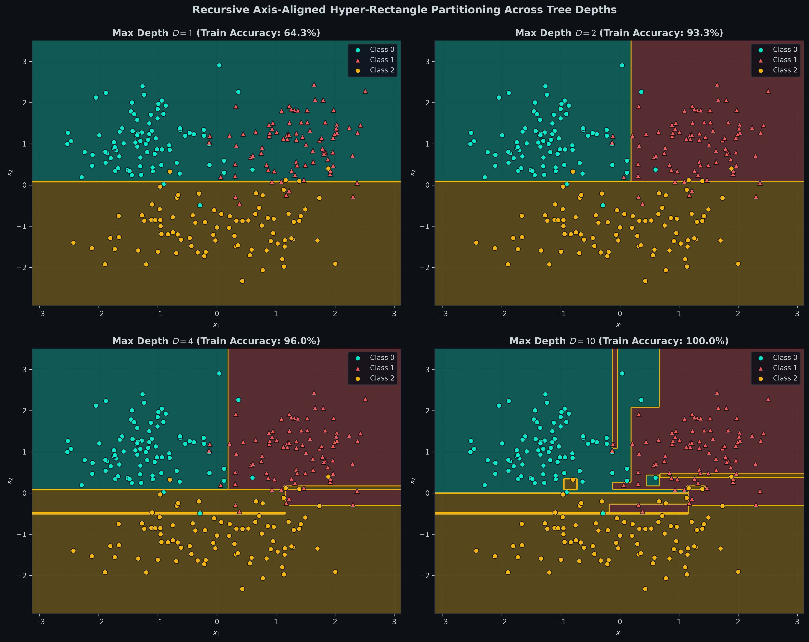
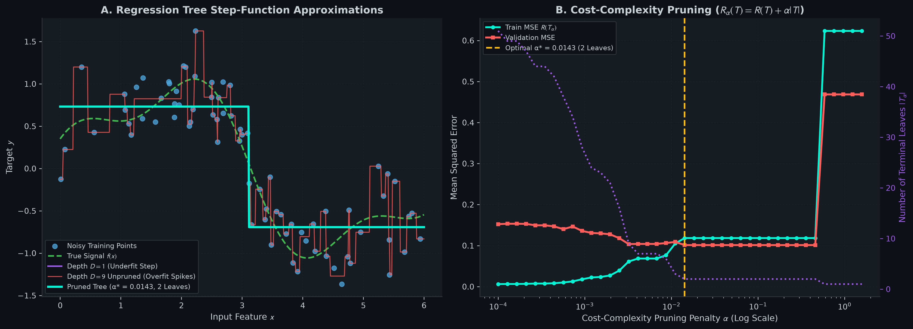
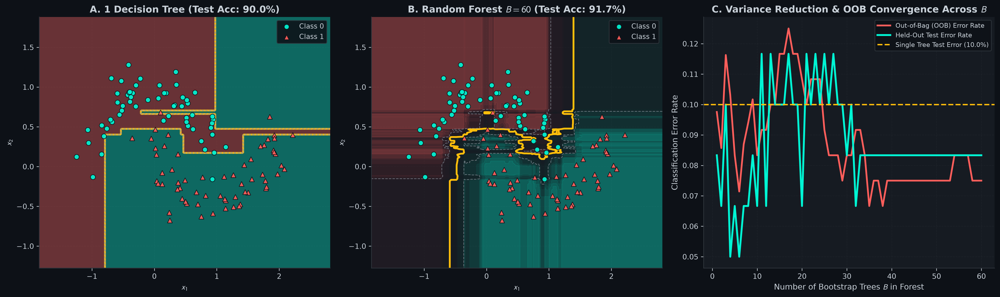
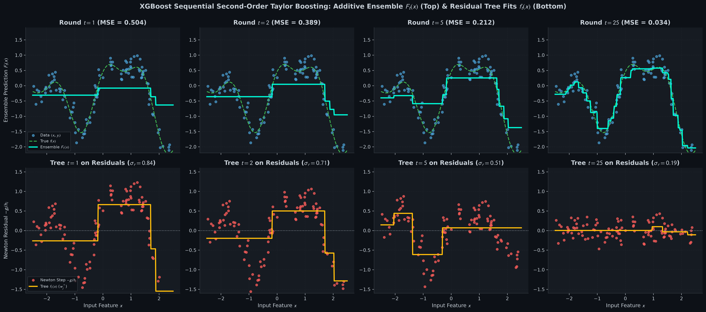

# Decision Trees, Random Forest, & XGBoost from Scratch: CART, Bagging, & Newton Boosting

[](#)
[](#)
[](#)

A complete, first-principles mathematical and practical implementation of **CART Decision Trees (Classification & Regression)**, **Cost-Complexity Pruning ($`R_\alpha(T)`$)**, **Random Forests (with Out-of-Bag Validation)**, and **Second-Order Taylor XGBoost** in pure vectorized NumPy.

---

## Table of Contents
1. [Geometric Intuition & Mental Models](#1-geometric-intuition--mental-models)
2. [Mathematical Formulations & Rigorous Derivations](#2-mathematical-formulations--rigorous-derivations)
   - [Node Impurity: Shannon Entropy, Gini, and the 2nd-Order Taylor Equivalence](#node-impurity-shannon-entropy-gini-and-the-2nd-order-taylor-equivalence)
   - [CART Splitting Algorithm & Information Gain](#cart-splitting-algorithm--information-gain)
   - [Regression Trees & Minimal Cost-Complexity Pruning ($`R_\alpha(T)`$)](#regression-trees--minimal-cost-complexity-pruning-r_alphat)
   - [The $`1 - e^{-1} \approx 63.212\%`$ Bootstrap Sampling Law](#the-1---e-1-approx-63212-bootstrap-sampling-law)
   - [Random Forests: The Variance Reduction Formula $`\rho\sigma^2 + \frac{1-\rho}{B}\sigma^2`$](#random-forests-the-variance-reduction-formula-rhosigma2--frac1-rhobsigma2)
   - [Second-Order Taylor XGBoost: Exact Derivation of Optimal Leaf Weights $`w_j^*`$ and Split Gain](#second-order-taylor-xgboost-exact-derivation-of-optimal-leaf-weights-w_j-and-split-gain)
3. [Visual Diagnostics & Empirical Verification](#3-visual-diagnostics--empirical-verification)
4. [Repository Architecture](#4-repository-architecture)
5. [Quickstart & Verification Suite](#5-quickstart--verification-suite)

---

## 1. Geometric Intuition & Mental Models

### The Recursive Slicer: Decision Trees
Imagine standing in an open field where two kinds of flowers grow in complex clusters. You are armed with a giant straight razor, but you can only make cuts that are strictly parallel to the North-South or East-West axes.
- At the root node, you search all possible vertical and horizontal cuts and choose the single cut that best separates the flowers into pure patches.
- You step into each resulting patch and repeat the process recursively.
- Geometrically, a decision tree divides feature space $`\mathbb{R}^n`$ into an orthogonal patchwork of **axis-aligned hyper-rectangles** (boxes). Each box predicts the majority class or the local average target value.

### The Wisdom of Uncorrelated Crowds: Random Forests
A single deep decision tree has low bias but suffers from catastrophic variance: if you wiggle a few training points, an early cut shifts, completely altering all downstream branches and producing jagged, overfitted boundaries.
Bagging (Bootstrap Aggregation) trains $`B`$ independent trees on random resamples of the training data. If every tree made identical errors, averaging them would provide zero benefit. 
By **randomly subsampling features** at every split (e.g., considering only $`\sqrt{n}`$ features), we forcefully decorrelate the trees. When uncorrelated trees vote together, their individual high-frequency errors cancel out like destructive wave interference, leaving behind a smooth, robust decision surface.

### The Succession of Sculptors: Gradient Boosting & XGBoost
Bagging builds trees in parallel to defeat variance. **Boosting** builds trees in sequence to defeat bias.
- Think of boosting as a team of sculptors carving a marble statue.
- The first sculptor creates a coarse rough outline of the figure ($`F_0(x)`$).
- Instead of starting from scratch, the second sculptor looks at the stone where the first sculptor left too much marble or chipped away too much (the **residuals** or **gradients** $`-g_i`$) and carves a tiny correction ($`f_1(x)`$).
- XGBoost equips each sculptor with a magnifying lens: it measures not only the direction of the error (the gradient $`g_i`$), but also the local curvature of the marble (the Hessian $`h_i`$), taking a precise, regularized **Newton-Raphson step** at every terminal leaf.

---

## 2. Mathematical Formulations & Rigorous Derivations

### Node Impurity: Shannon Entropy, Gini, and the 2nd-Order Taylor Equivalence

Let a node contain a sample set $`S`$ with label distribution $`p_c = \frac{1}{|S|} \sum_{i \in S} \mathbb{I}(y^{(i)} = c)`$ for classes $`c \in \{1, \dots, K\}`$.

#### 1. Shannon Entropy (in bits):

```math
H(S) = -\sum_{c=1}^K p_c \log_2(p_c)
```

Measures the average information (surprise) in bits required to encode the class of an arbitrary sample drawn from $`S`$.

#### 2. Gini Impurity:

```math
G(S) = 1 - \sum_{c=1}^K p_c^2 = \sum_{c=1}^K p_c (1 - p_c)
```

Measures the probability that a randomly chosen element would be incorrectly labeled if it were randomly labeled according to the distribution of labels in the node.

#### Taylor Series Proof: Why Gini is a First-Order Polynomial Approximation of Entropy
Consider the natural logarithm version of entropy: $`H_e(S) = -\sum_{c=1}^K p_c \ln(p_c)`$.
Recall the first-order Taylor series expansion of $`\ln(x)`$ centered around $`x = 1`$:

```math
\ln(x) = (x - 1) - \frac{(x - 1)^2}{2} + \mathcal{O}((x - 1)^3)
```

Substituting $`x = p_c`$:

```math
\ln(p_c) \approx p_c - 1
```

Multiplying by $`-p_c`$ and summing across all $`K`$ classes:

```math
H_e(S) \approx -\sum_{c=1}^K p_c (p_c - 1) = \sum_{c=1}^K p_c (1 - p_c) = 1 - \sum_{c=1}^K p_c^2 = G(S)
```

Gini impurity is literally the second-order Taylor approximation of entropy, which eliminates costly transcendental `log` calls while yielding almost identical split decisions!

---

### CART Splitting Algorithm & Information Gain

For a candidate split on feature $`j`$ at numerical threshold $`t`$:

```math
S_L = \{(\mathbf{x}^{(i)}, y^{(i)}) \in S : x_j^{(i)} \le t\}, \quad S_R = \{(\mathbf{x}^{(i)}, y^{(i)}) \in S : x_j^{(i)} > t\}
```

The **Information Gain** (or impurity reduction) is:

```math
\Delta I(S, j, t) = I(S) - \left( \frac{|S_L|}{|S|} I(S_L) + \frac{|S_R|}{|S|} I(S_R) \right)
```

To evaluate splits on continuous features in $`O(m \log m)`$ time:
1. Sort unique values: $`u_1 < u_2 < \dots < u_k`$.
2. Form split candidates at midpoints: $`t_r = \frac{u_r + u_{r+1}}{2}`$.
3. Select $`(j^*, t^*) = \arg\max_{j, t} \Delta I(S, j, t)`$.

---

### Regression Trees & Minimal Cost-Complexity Pruning ($`R_\alpha(T)`$)

For continuous target $`y \in \mathbb{R}`$, node impurity is empirical variance:

```math
\mathrm{Var}(S) = \frac{1}{|S|} \sum_{i \in S} (y^{(i)} - \bar{y}_S)^2 \quad \text{where } \bar{y}_S = \frac{1}{|S|} \sum_{i \in S} y^{(i)}
```

Total weighted mean squared error across all terminal leaves $`|T|`$:

```math
R(T) = \sum_{t \in \widetilde{T}} \frac{|S_t|}{m} \mathrm{Var}(S_t) = \frac{1}{m} \sum_{i=1}^m (y^{(i)} - \hat{y}^{(i)})^2
```

#### Minimal Cost-Complexity Objective
Deep trees with 1 sample per leaf achieve $`R(T) = 0`$ on training data but overfit drastically.
Breiman's Minimal Cost-Complexity Pruning defines the penalized cost:

```math
R_\alpha(T) = R(T) + \alpha |T|
```

where $`|T|`$ is the number of terminal leaves and $`\alpha \ge 0`$ penalizes tree complexity.

For each internal node $`t`$:
- If node $`t`$ is collapsed into a single leaf, its error is $`R(t)`$.
- If the subtree $`T_t`$ rooted at $`t`$ is kept, its error is $`R(T_t) + \alpha |T_t|`$.

Setting $`R(t) + \alpha = R(T_t) + \alpha |T_t|`$ yields the **effective critical alpha**:

```math
\alpha_{\text{eff}}(t) = \frac{R(t) - R(T_t)}{|T_t| - 1}
```

The weakest link with minimal $`\alpha_{\text{eff}}`$ is pruned first, generating a nested sequence of optimal subtrees $`T_0 \supset T_1 \supset T_2 \dots`$ validated via held-out validation data.

---

### The $`1 - e^{-1} \approx 63.212\%`$ Bootstrap Sampling Law

In Bagging, a dataset of size $`m`$ is sampled $`m`$ times **with replacement** (bootstrap sample $`\mathcal{D}_b`$).

#### Derivation of Sample Inclusion Probability:
The probability that a specific observation $`i`$ is NOT selected in a single random draw is:

```math
P(\text{not selected in 1 draw}) = 1 - \frac{1}{m}
```

Because all $`m`$ draws are mutually independent:

```math
P(\text{not selected in all } m \text{ draws}) = \left( 1 - \frac{1}{m} \right)^m
```

Taking the limit as dataset size $`m \to \infty`$:

```math
\lim_{m \to \infty} \left( 1 - \frac{1}{m} \right)^m = e^{-1} \approx 0.367879441
```

Therefore, the asymptotic probability that sample $`i`$ is included in the bootstrap bag is:

```math
P(\text{included in bag}) = 1 - \left( 1 - \frac{1}{m} \right)^m \xrightarrow{m \to \infty} 1 - e^{-1} \approx 63.212\%
```

#### Out-of-Bag (OOB) Validation
Approximately $`36.79\%`$ of samples are **never seen** by tree $`b`$. For every sample $`i`$, we evaluate predictions using only the sub-ensemble of trees for which sample $`i`$ was out-of-bag:

```math
\hat{y}_{\text{OOB}}^{(i)} = \arg\max_c \sum_{b : i \in \text{OOB}_b} \mathbb{I}(\hat{y}_b(\mathbf{x}^{(i)}) = c)
```

This delivers an unbiased generalization error estimate identical to $`K`$-fold cross-validation at zero extra computational training cost!

---

### Random Forests: The Variance Reduction Formula $`\rho\sigma^2 + \frac{1-\rho}{B}\sigma^2`$

Consider an ensemble of $`B`$ identical, identically distributed (but correlated) tree estimators $`\hat{f}_b(\mathbf{x})`$, each having variance $`\mathrm{Var}(\hat{f}_b) = \sigma^2`$ and pairwise correlation $`\mathrm{Corr}(\hat{f}_b, \hat{f}_{b'}) = \rho`$ for $`b \ne b'`$.

The variance of the ensemble average $`\bar{f}(\mathbf{x}) = \frac{1}{B} \sum_{b=1}^B \hat{f}_b(\mathbf{x})`$ is:

```math
\mathrm{Var}\left( \frac{1}{B} \sum_{b=1}^B \hat{f}_b \right) = \frac{1}{B^2} \left[ \sum_{b=1}^B \mathrm{Var}(\hat{f}_b) + \sum_{b=1}^B \sum_{b' \ne b} \mathrm{Cov}(\hat{f}_b, \hat{f}_{b'}) \right]
```

```math
= \frac{1}{B^2} \left[ B \sigma^2 + B(B - 1) \rho \sigma^2 \right] = \frac{\sigma^2}{B} + \frac{B - 1}{B} \rho \sigma^2
```

```math
\mathrm{Var}(\bar{f}) = \rho \sigma^2 + \frac{1 - \rho}{B} \sigma^2
```

#### Crucial Insights:
1. As $`B \to \infty`$, the second term $`\frac{1 - \rho}{B} \sigma^2 \to 0`$.
2. The remaining irreducible variance floor is $`\rho \sigma^2`$.
3. Standard bagging cannot reduce $`\rho`$. **Random Forests actively decrease $`\rho`$** by randomly forcing each node to consider only a subset of features (e.g. $`k = \lfloor\sqrt{n}\rfloor`$), breaking the dominance of strong predictor variables and lowering the irreducible floor!

---

### Second-Order Taylor XGBoost: Exact Derivation of Optimal Leaf Weights $`w_j^*`$ and Split Gain

Let the ensemble prediction at boosting round $`t`$ be:

```math
\hat{y}_i^{(t)} = \hat{y}_i^{(t-1)} + f_t(\mathbf{x}^{(i)})
```

The regularized objective function to minimize at round $`t`$ is:

```math
\mathcal{L}^{(t)} = \sum_{i=1}^m l(y^{(i)}, \hat{y}_i^{(t-1)} + f_t(\mathbf{x}^{(i)})) + \Omega(f_t)
```

where the tree complexity penalty is defined as:

```math
\Omega(f_t) = \gamma T + \frac{1}{2} \lambda \sum_{j=1}^T w_j^2
```

with $`T`$ terminal leaves, leaf weights $`w_j \in \mathbb{R}`$, $`L_2`$ leaf penalty $`\lambda`$, and minimum split penalty $`\gamma`$.

#### 1. Second-Order Taylor Expansion
Expanding the loss function around the current prediction $`\hat{y}_i^{(t-1)}`$:

```math
l(y^{(i)}, \hat{y}_i^{(t-1)} + f_t(\mathbf{x}^{(i)})) \approx l(y^{(i)}, \hat{y}_i^{(t-1)}) + g_i f_t(\mathbf{x}^{(i)}) + \frac{1}{2} h_i f_t(\mathbf{x}^{(i)})^2
```

where the first-order gradient and second-order Hessian are:

```math
g_i = \left. \frac{\partial l(y^{(i)}, \hat{y})}{\partial \hat{y}} \right|_{\hat{y} = \hat{y}_i^{(t-1)}}, \quad h_i = \left. \frac{\partial^2 l(y^{(i)}, \hat{y})}{\partial \hat{y}^2} \right|_{\hat{y} = \hat{y}_i^{(t-1)}}
```

Removing constant terms independent of $`f_t`$, the surrogate objective simplifies to:

```math
\widetilde{\mathcal{L}}^{(t)} = \sum_{i=1}^m \left[ g_i f_t(\mathbf{x}^{(i)}) + \frac{1}{2} h_i f_t(\mathbf{x}^{(i)})^2 \right] + \gamma T + \frac{1}{2} \lambda \sum_{j=1}^T w_j^2
```

#### 2. Grouping by Leaf Partition $`I_j`$
Let $`I_j = \{i : q(\mathbf{x}^{(i)}) = j\}`$ be the set of sample indices assigned to leaf $`j`$.
Rewriting the sum over samples as a sum over leaves:

```math
\widetilde{\mathcal{L}}^{(t)} = \sum_{j=1}^T \left[ \left( \sum_{i \in I_j} g_i \right) w_j + \frac{1}{2} \left( \sum_{i \in I_j} h_i + \lambda \right) w_j^2 \right] + \gamma T
```

Let $`G_j = \sum_{i \in I_j} g_i`$ and $`H_j = \sum_{i \in I_j} h_i`$:

```math
\widetilde{\mathcal{L}}^{(t)} = \sum_{j=1}^T \left[ G_j w_j + \frac{1}{2} (H_j + \lambda) w_j^2 \right] + \gamma T
```

#### 3. Solving for the Optimal Leaf Weight $`w_j^*`$
Taking the partial derivative with respect to leaf weight $`w_j`$ and setting to zero:

```math
\frac{\partial \widetilde{\mathcal{L}}^{(t)}}{\partial w_j} = G_j + (H_j + \lambda) w_j = 0 \implies w_j^* = -\frac{G_j}{H_j + \lambda} = -\frac{\sum_{i \in I_j} g_i}{\sum_{i \in I_j} h_i + \lambda}
```

#### 4. Optimal Tree Quality Score & Split Gain Formula
Substituting $`w_j^*`$ back into the objective yields the optimal score of tree structure $`q`$:

```math
\mathcal{L}^*(q) = -\frac{1}{2} \sum_{j=1}^T \frac{G_j^2}{H_j + \lambda} + \gamma T
```

When evaluating a split of node $`P`$ into left child $`L`$ and right child $`R`$:

```math
\text{Gain} = \mathcal{L}_{\text{before}} - \mathcal{L}_{\text{after}} = \frac{1}{2} \left[ \frac{G_L^2}{H_L + \lambda} + \frac{G_R^2}{H_R + \lambda} - \frac{(G_L + G_R)^2}{H_L + H_R + \lambda} \right] - \gamma
```

A split is made if and only if $`\text{Gain} > 0`$. If the gain is less than $`\gamma`$, the node is not split (automatic structural pruning)!

---

## 3. Visual Diagnostics & Empirical Verification

### Diagnostic Plot 1: Impurity Functions & Midpoint Split Search
Generated by [01_impurity_and_decision_trees.ipynb](01_impurity_and_decision_trees.ipynb).



- **Panel A (Impurity Curves):** Visualizes the exact parabolic symmetry of Gini $`2p(1-p)`$ and scaled Shannon entropy $`\frac{1}{2}H(p)`$.
- **Panel B (Threshold Sweep):** Exhaustive evaluation of adjacent midpoints $`t = \frac{u_r + u_{r+1}}{2}`$, locating the global maximum Information Gain split at $`t^* = 0.05`$.

---

### Diagnostic Plot 2: Recursive Axis-Aligned Partitioning
Generated by [01_impurity_and_decision_trees.ipynb](01_impurity_and_decision_trees.ipynb).



- Depths $`D \in \{1, 2, 4, 10\}`$ illustrate how linear orthogonal cuts progressively tile $`\mathbb{R}^2`$ into rectangular decision regions, evolving from coarse underfitting to fine-grained boundary memorization.

---

### Diagnostic Plot 3: Regression Tree Step Approximations & Minimal Cost-Complexity Pruning
Generated by [02_regression_trees_and_pruning.ipynb](02_regression_trees_and_pruning.ipynb).



- **Panel A (Step Functions):** Compares a single coarse split ($`D=1`$), an overfitted unpruned tree ($`D=9`$) fitting random noise spikes, and the optimal pruned tree ($`\alpha^* = 0.0143`$) capturing the underlying sinusoidal signal.
- **Panel B (Pruning Tradeoff):** Sweeping $`\alpha`$ across 5 orders of magnitude exposes the validation MSE U-curve and corresponding leaf count shrinkage.

---

### Diagnostic Plot 4: Random Forest Variance Reduction & OOB Error Convergence
Generated by [03_bagging_and_random_forest.ipynb](03_bagging_and_random_forest.ipynb).



- **Panel A vs. Panel B:** A single tree ($`B=1`$) forms irregular, noise-sensitive rectangular islands. An ensemble of $`B=60`$ decorrelated trees produces a smooth, generalized manifold.
- **Panel C (OOB vs. Test):** Tracks the monotonic decline and stable convergence of Out-of-Bag error rate alongside independent test error as trees are added.

---

### Diagnostic Plot 5: XGBoost Sequential Second-Order Boosting Progression
Generated by [04_gradient_boosting_and_xgboost.ipynb](04_gradient_boosting_and_xgboost.ipynb).



- **Top Row (Additive Ensemble $`F_t(x)`$):** Step-by-step convergence of the additive model $`F_t(x) = \sum_{k=1}^t \eta f_k(x)`$ towards the true complex multi-frequency function across rounds $`t \in \{1, 2, 5, 25\}`$.
- **Bottom Row (Newton Residuals & Tree Fits):** Displays the shrinking pseudo-residuals $`-g_i / h_i`$ and the individual shallow tree approximations $`f_t(x)`$ fitted to them at each stage.

---

## 4. Repository Architecture

```text
decision-trees-random-forest-xgboost/
├── README.md                                          # Mathematical textbook & complete guide
├── requirements.txt                                   # numpy, matplotlib
├── .gitignore                                         # Git ignore rules
├── src/
│   ├── __init__.py                                    # Package exposure
│   ├── plot_theme.py                                  # GitHub Dark Mode (#0D1117) styling engine
│   └── trees_engine.py                                # Unified engine: CART, RF, OOB, Pruning, XGBoost
├── 01_impurity_and_decision_trees.ipynb               # Entropy/Gini geometry, continuous splits, OHE
├── 02_regression_trees_and_pruning.ipynb               # Piecewise step fitting & Cost-Complexity Pruning
├── 03_bagging_and_random_forest.ipynb                 # 63.2% Bootstrap law, OOB error, decorrelation
├── 04_gradient_boosting_and_xgboost.ipynb             # Second-order Taylor boosting, Newton residuals
└── assets/
    ├── 01_gini_vs_entropy_impurity_curve.png         # 300-DPI impurity metrics & split sweep
    ├── 02_recursive_feature_space_partitioning.png    # 300-DPI 2D rectangular decision partition
    ├── 03_regression_tree_step_fitting.png            # 300-DPI step function fitting & pruning curve
    ├── 04_rf_variance_reduction_boundary.png          # 300-DPI RF vs Single Tree & OOB convergence
    └── 05_xgboost_sequential_residual_fitting.png     # 300-DPI 2x4 XGBoost residual shrinkage
```

---

## 5. Quickstart & Verification Suite

### Installation
Clone this repository and install dependencies:
```bash
git clone https://github.com/Necromancer0912/decision-trees-random-forest-xgboost.git
cd decision-trees-random-forest-xgboost
pip install -r requirements.txt
```

### Running the Mathematical Verification Suite
Run the mathematical invariant and numerical finite-difference test suite:
```bash
python -m src.trees_engine
```

Expected output:
```text
========================================================================
MODULE 05: DECISION TREES, RANDOM FOREST & XGBOOST — VERIFICATION SUITE
========================================================================
[Grad/Hess Check] XGBoost MSE     | g_i Error: 3.556e-11 | h_i Error: 2.348e-12 (< 1e-7 PASS)
[Grad/Hess Check] XGBoost LOGLOSS | g_i Error: 1.200e-10 | h_i Error: 8.919e-12 (< 1e-7 PASS)
[Bootstrap Law] Empirical Unique In-Bag: 63.60% vs. Theoretical (1 - 1/e) = 63.21% | OOB Acc: 93.00%
========================================================================
```

